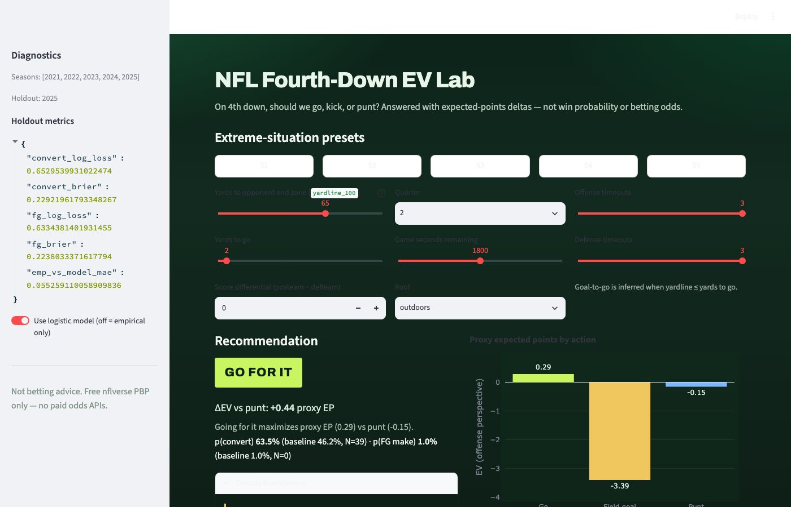
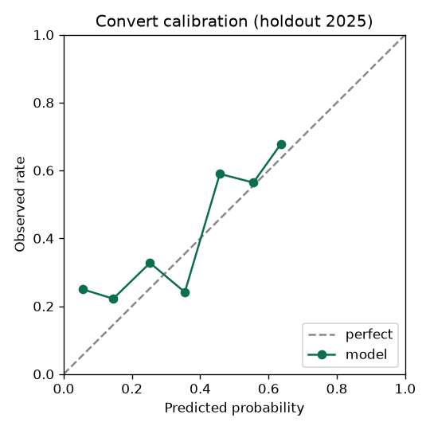
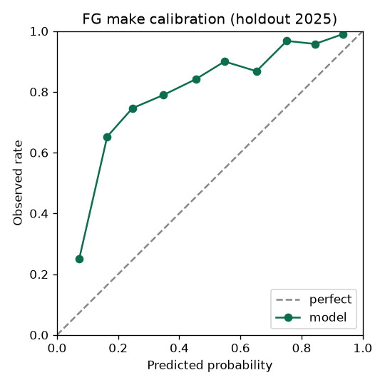
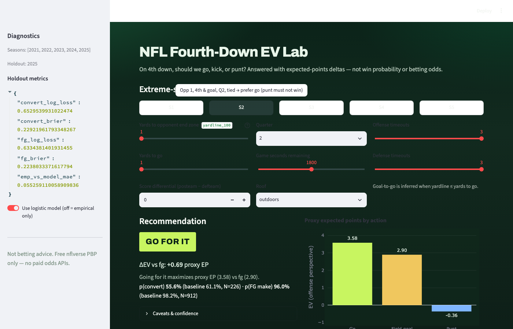
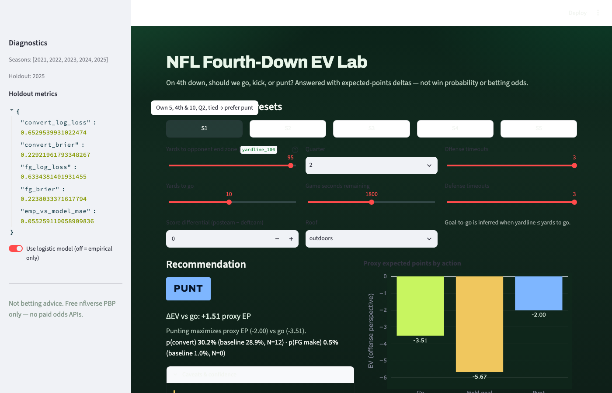

# NFL Fourth-Down EV Lab

**Stakeholder one-liner:** A situation console that turns nflverse play-by-play into a defendable go / kick / punt recommendation with expected-points deltas and known failure modes.

## 60-second exec summary

| | |
| --- | --- |
| **Question** | On 4th down, given game state, should we **go**, attempt a **field goal**, or **punt**? |
| **Data** | Free [nflverse](https://github.com/nflverse/nflverse-data) PBP parquet, REG seasons **2021–2025** |
| **Answer shape** | EV(go), EV(FG), EV(punt) under one proxy-EP convention → recommend argmax + **ΔEV vs next best** + caveats |
| **Takeaways** | (1) Empirical tables + logistic beats “coach gut” storytelling for interviews. (2) Season holdout + calibration matter more than accuracy. (3) Late-game EP ≠ win value — we show that caveat instead of faking WP. |



## How to run

```bash
git clone https://github.com/akshay-bhatkhande/nfl-fourth-down-ev-lab.git
cd nfl-fourth-down-ev-lab
python -m venv .venv
source .venv/bin/activate   # Windows: .venv\Scripts\activate
pip install -r requirements.txt

python scripts/download_pbp.py      # → data/raw/*.parquet (gitignored)
python scripts/build_mart.py        # → data/processed/fourth_downs.parquet
python scripts/train_models.py      # → artifacts/ (small JSON + joblib committed)

pytest -q
streamlit run app.py
```

**Offline:** if GitHub releases are unreachable, place `play_by_play_YYYY.parquet` (or `.csv.gz`) manually in `data/raw/` for ≥3 consecutive seasons from 2021–2025, then run `build_mart` → `train_models`.

Committed `artifacts/` let you open the Streamlit app and run sanity tests without re-downloading, but retrain after a fresh download for reproducibility.

## Method

- **Universe:** `down == 4`, `season_type == 'REG'`, `play_type ∈ {pass, run, field_goal, punt}`.
- **Convert label:** go attempt converts if `first_down == 1` **or** `touchdown == 1`.
- **Baseline:** empirical P(convert | yardline × ydstogo), P(FG make | kick-distance proxy), punt EP-by-yardline bucket; **min cell N = 30** with backoff.
- **Model:** `sklearn` **LogisticRegression** (scaled) for convert + FG make. Features are **pre-play only** (see `docs/decisions.md` for leaky rejects).
- **Split:** train **2021–2024**, holdout **2025**.
- **EV:** proxy expected points; FG make = **+3**, miss = −EP at heuristic spot; details frozen in `docs/decisions.md`.
- **FG distance at decision time:** `yardline_100 + 17`. Kicks ≥65 / ≥70 yards are hard-capped (no borrowing short-kick make rates).

## Holdout metrics (2025)

| Model | Log-loss | Brier | Notes |
| --- | --- | --- | --- |
| Convert (logistic) | **0.653** | **0.229** | Emp. vs model bucket MAE ≈ **0.055** |
| FG make (logistic) | **0.633** | **0.224** | Long kicks capped in product EV |

Calibration (reliability diagrams written by `train_models.py`):




**Baseline globals (train seasons):** convert ≈ see `artifacts/metrics.json` / conversion table; FG make league rate ≈ 0.86 on attempted kicks (dominated by shorter tries).

## Where it fails (error slices)

Holdout convert slices (yardline thirds × ydstogo) show the usual sports-analytics pattern:

1. **Short yardage is better calibrated than long** — midfield 4th & 6+ is sparse and noisy; Brier rises when observed conversion is rare.
2. **Opponent-territory long-yardage go attempts** are the worst convert slice (small N, model under-predicts opportunistic conversions).
3. **FG logistic under-predicts make rate on “own/mid” attempts that are actually short kicks** after the distance transform — the empirical distance table is the safer display baseline for long attempts; the app blends toward it when cells are thin.

Sanity suite **S1–S5** (own-territory punt, goal-line go, short-yardage competitive, long-yardage anti-go, late trailing go vs punt) is enforced in `tests/test_ev_sanity.py`.

## Demo

| Preset | Screenshot |
| --- | --- |
| Default (own 35, 4th & 2) |  |
| S2 goal line |  |
| S1 own territory |  |

Animated walkthrough: `docs/images/demo.gif` (also copied to the portfolio media store).

## Limitations + next measurements

- Proxy EP, not win probability; late/large score differentials need a WP layer.
- League-average only — no QB/team effects, limited roof signal.
- FG/punt field-position heuristics (documented).
- **Next:** WP overlay, opponent-adjusted conversion, weather, coach-choice audit chart (descriptive, not causal).

## AI-to-ship note

AI accelerated scaffolding, download retries, and UI layout. **Human-owned:** EV convention, leaky-feature ban list, min-N=30, cut of WP/odds/model-zoo. See `docs/build-log.md` and `docs/decisions.md`.

## Attribution

Play-by-play from [nflverse/nflverse-data](https://github.com/nflverse/nflverse-data) / nflfastR. Cite nflverse in any derivative work. **Not betting advice.** No paid odds APIs.
